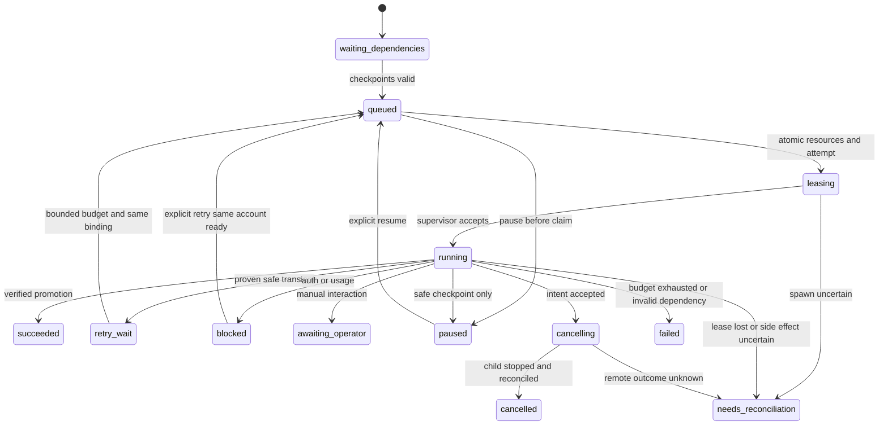

# Durable orchestration và recovery

Thiết kế M05/M13/M15, chưa chạy queue/worker. Chọn Mongo queue trên replica set một node, [ADR03](decisions.md); canonical [collections/indexes](mongodb-schema.md), [API](api-contracts.md), [provider affinity](provider-architecture.md). Không bật tự động đổi account khi quota/auth failure. Bảo đảm local state at-least-once delivery + fenced commit; **không hứa exactly-once external inference/publish**.

## Mongo queue so với Redis

| Tiêu chí | Mongo-backed (chọn) | Redis-backed (chưa dùng) |
|---|---|---|
| Durable source + transactions | Job/resource/Story/event/idempotency cùng transaction | Cần Mongo outbox→Redis + inbox/dedupe; dual-write trực tiếp có khoảng mất/trùng |
| Windows operations | Đã cần Mongo, ít service và backup hơn | Cần vận hành Redis được hỗ trợ trong topology chọn, persistence/failover riêng; không giả một Redis process native Windows sẵn có |
| Scheduling/delay/query | Index notBefore/priority/enqueueSeq, polling≤2s; đủ planning V1 | Streams + delayed scheduling structure + claims/ACK; tốt khi throughput lớn nhưng complexity hơn |
| Recovery | Atomic claim/fence và resource CAS kiểm soát | Pending reclaim không biết remote request đã được gửi; vẫn cần receipt/fence trong Mongo |
| Scale | Claim contention đo với mock; giữ transaction nhỏ | Chỉ xem lại sau benchmark; Mongo outbox vẫn authority, Redis là wakeup/delivery; không đổi external safety contract |

## Stage/job vocabulary

`Stage={caption,content_rewrite,visual_prompts,plan,chapter,story_assemble,opening_image,prompt_suggestion,clip1,last_frame,clip2,merge,external_attach,axcel_scan,axcel_import,axcel_frame,manual_save,website_publish,link_resolve,sheets_export,local_export,discovery,migration_import,backup,provider_diagnostic}`. `chapter` có ordinal1–5 trong checkpoint/activeKey; bounded stageArgs được validate theo stage, không script string. File state UI step1…5 ánh xạ stage vocabulary, không nhầm internal B1/B2.

`JobState={waiting_dependencies,queued,leasing,running,retry_wait,paused,blocked,awaiting_operator,cancelling,cancelled,succeeded,failed,needs_reconciliation,superseded}`. `active=true` cho tất cả nonterminal bao gồm paused/blocked/needs_reconciliation; terminal succeeded/failed/cancelled/superseded active=false. ActiveKey unique giữ một logical task cùng Story/generation/stage/ordinal; terminal retry dùng resume command tạo **successor job** hoặc reopen cùng logical job sau transaction kiểm unique, không overwrite attempt history. Chọn V1 successor job có parentJobId (optional ID), cùng generation/checkpoint khi safe resume; ambiguous chỉ resolution, không enqueue successor inference.



Outcome≠Story operatorDone≠merged complete≠clipboard ACK. Failed parent workflow có partial outputs; DAG readiness chỉ dùng validated checkpoint đúng lineage. Preview/planning/poll không gọi generation. Concurrency cấp **invocation**, không giữ account slot suốt parent pipeline/5chapter. Queue rows chưa được dispatch là pending/dependencies, không gọi queued worker giả.

## Durable enqueue và scheduler ownership

1. API command xác minh membership/role/Idempotency-Key/If-Match, workspace ownership=web/admission gate, frozen prompt/config/revision hash. TX01 ghi workflow/jobs/dependencies + idempotency resource response + audit/events. OperationID do server, không lấy arbitrary legacy job_id làm auth.
2. Scheduler leader lease key org/workspace/run chỉ tối ưu scan (lease30s, heartbeat10s). Hết leader lease host khác có thể plan, nhưng từng dispatch vẫn TX02 chạm run.controlVersion + workspace gate + activeKey unique; không hai scheduler cấp hai task cùng stage. Đợi dependencies không dùng provider resource.
3. DAG text: caption→content→visual; sau visual fork B3 PLAN/chapter/assemble và media. Stage1/2 stop scopes chỉ tạo required DAG. Axcel text bỏ content/visual, Caption→PLAN; B2 N/A. Stop-after-clip1 hoàn tất selected-output contract nhưng merge stage không complete. External final không enqueue clip jobs.
4. Batch scheduling giữ excel/balanced_type/weighted_type, TYPE caps/spillover theo Phase01. TX cấp job cập nhật launch count/controlVersion trước event; error row không chặn queue khác. Multi-queue migration chỉ sau drained handoff; limits text8/gpt6/grok2 default, nhưng min với host/provider entitlement. Axcel global run materialize selected rows theo root/Story displayNo; retry_only chọn server-side; capacity1–24 chỉ task coordinator trần, không tăng AI concurrency.

## Claim protocol, locks và fencing

Resource key catalog: `host/{id}/cpu`, `host/{id}/text`, `host/{id}/media`, `provider/codex/account/{id}`, `provider/siwc/org` (V1 cap1 toàn installation), `profile/{provider}/{host}/{id}`, `workspace/{id}/step4|step5`, `batch/{id}/lane/{lane}`, `site/{account}/publish` (cap1). Key có org scope, server tạo; client không tự định resource/slot. Account shared workspaces vẫn một resource doc org-account, không nhân slot theo workspace. Capacity tối đa min(operator,host,verified entitlement); count waiting không tiêu slot. Legacy limit0 bỏ workspace stage gate, **không** vô hiệu provider/host hard cap.

Story conflict gate ở stories.control.reservations, tối đa8key: text2 (caption/content/visual mutation), b3, media (opening/clip/frame/merge), metadata, publish. Matrix: text2 xung đột với text2/b3/media/publish; b3 xung đột text2/b3/manual-B3/publish; media xung đột text2/media/external/manual-media; metadata chỉ tương tác fields theo CAS; publish khóa revision snapshot + LINK mutation, có thể chạy media không sửa source image đã pin. Claim các stage B3 và media phải update **cùng Story control doc** rồi resource docs theo sorted key nên write-conflict serialize quyết định, nhưng giữ reservations khác nhau cho chạy song song. Manual/FORCE/trash lấy exclusive mutation gate và fail409 nếu incompatible active; FORCE step2 chỉ bảo toàn completed B3/media snapshots, không đổi chúng thành lineage mới.

TX02 algorithm:

```text
Select candidate from indexed ready queue (outside transaction, advisory).
Transaction snapshot: read serverNow from Mongo, require workspace web/admission and run not paused.
Write/touch workspace gate + run controlVersion + worker enrollment/revocation gate.
CAS candidate queued/version/dependencies/revision/generation, notBefore <= serverNow.
Validate explicit account binding/grant and host capability; reject changed account/model snapshot.
Update Story conflict reservations; CAS each resource free slot, increment persistent fence counters.
Write lease(epoch=job previous epoch+1, attemptId, hostId, bootId, expiresAt=serverNow+90s).
Insert job_attempt and transactional events(streamSeq/jobSeq); job=leasing; commit majority+journal.
After commit only: dispatch signed envelope to enrolled supervisor. Never spawn inside retryable TX callback.
```

No child accepted within30s → reconciliation, not blind redispatch. Worker ACK enqueued task ID+attempt+epoch, idempotent; child spawn local intent journal includes host/boot/PID+birth/Windows Job Object before running. Supervisor may reconnect and return same attempt status. PID không có ý nghĩa trên host khác; fence ownership có.

Heartbeat every15s; worker considered suspect at45s no heartbeat, lease expires90s using **DB server time**; UI ghi stale/suspect trước offline, không đánh failed ngay. TX03 gia hạn cả job/resource claims có owner/boot/attempt/epoch, lease not expired; bất kỳ conflict/DB error abort. Worker không nhận renewal trong30s kể từ last confirmed, hoặc còn<30s lease budget → ngừng xin submit permit, cancel safe local work; không chờ TTL. HTTP worker/client clock chỉ diagnostic, không authoritative expiry.

## External submit gate và stale-worker protection

Fencing Mongo **không thể ngăn một browser/CLI cũ gửi remote** sau khi mất mạng. Vì vậy lease expiry không tự free/reassign slot cho side-effect task. Trước mỗi external invocation, child xin `prepare-submission`; internal API xác minh lease/grants/lineage/cancel, tạo operationId+receipt submit_intent và short permit10s gắn attempt/account/requestHash. Child ghi durable local intent rồi submit một lần; phase submitted/result_verified cập nhật bằng same fence. Race cancel sau cấp permit có thể đã gửi: báo cancelling/needs_reconciliation, không hứa cancel đã thu hồi remote request.

Khi lease mất: tăng fence thu hồi quyền canonical commit, đánh resources liên quan **quarantined**, đòi supervisor proof child tree ended (hostId/bootId/PID birth) và receipt/media reconciliation trước release. Nếu host offline không có proof, giữ quarantine; operator phải xác minh host đã tắt/child đã dừng hoặc remote outcome, không auto dispatch elsewhere. New boot enrollment bằng cùng host identity chỉ chứng minh OS đã reboot khi supervisor xác minh boot epoch; old attempt không được tiếp tục. Unknown ngoại vi vẫn cần reconciliation dù process chết.

Local deterministic jobs như hash/frame/merge có thể tạo successor sau worker-offline90s, explicit no-external capability và private attempt dirs + canonical fence. Cũ và mới có thể compute cùng lúc nhưng không cùng canonical writer. Quota gates/account profile slots không bao giờ bị expire/TTL-delete để vượt uncertainty. Submit intent trước remote action nhưng crash chưa gửi không phân biệt chắc: reconcile local evidence hoặc awaiting_operator; chấp nhận false-positive blocking để tránh duplicate.

## Checkpoint commit và ownership

Child chỉ ghi `<namespace>/<story>/<generation>/<stage>/<attempt>/<fence>/...` spool; không viết Story canonical folder/DB. Output contract gồm bytes manifests+hases, input lineage, validator result, actual binding evidence, receipts. M08 verify/re-hash immutable asset bytes rồi TX04 CAS job lease/current generation + Story control epoch + resource epochs → checkpoint/refs + field-level projection + event/state/slot release. Output stale được giữ quarantined evidence, không promote. DB unavailable → giữ spool/receipt, không hoàn thành giả; reconnect cùng attempt hỏi status trước publish/retry.

Checkpoint version tuple `(sourceHash,promptHash,inputHashes,format,validatorProfile,adapterVersion,generation)` quyết định resume. Mismatch→409 LINEAGE_MISMATCH hoặc new generation FORCE preview. Chapter1…5 commit từng chapter; B1 content checkpoint trước B2; artifact downloaded nhưng parent chết có thể adopt sau verify hash/evidence. Changing image marks video stale; changing clip1 invalidates frame/clip2/merge; retry clip2 giữ clip1/frame; merge-only không gọi Grok. [Adapters](legacy-adapter-design.md) mô tả folder materialization.

## Retry budget và account affinity

Một tầng retry controller M05 đếm invocation attempts, adapter không ẩn thêm vòng retry vượt envelope. Automatic caption/content attempts default3 (range1–10); visual3 (1–10); PLAN2/ACT3 (1–5), mỗi lần regenerate content đều được tính. Transport text tối đa2 retries2s/5s, model_capacity3retries10s/30s/60s **same account/model**; slots nhả trước retry_wait và cấp lại sau. Global invocation ceiling per task min(config60,hard100); validation/network counters độc lập nhưng total ceiling chặn tích số loops. Long writer legacy cần callback budget nếu reuse loop; không chạy cả legacy `_invoke` retries và M05 retries.

| Lỗi | Automatic action | Operator/recovery |
|---|---|---|
| AUTH_EXPIRED / AUTH_UNVERIFIED | blocked/awaiting_operator, no retry login/switch | Local login cùng account, status positive, explicit resume |
| USAGE_LIMITED | blocked; giữ affinity, lưu retryAt chỉ khi evidence có absolute date/timezone; clock-only hint giữ text+10min local conservative gate | Gate hết không tự né quota; retry cùng account sau readiness/explicit batch resume policy, không chuyển profile |
| NETWORK_ERROR trước submit chắc chắn | Text bounded retry same binding; media chỉ retry nếu proof not_submitted | Nếu không chứng minh phase→needs_reconciliation |
| MODEL_CAPACITY | Text bounded backoff same model, không gắn quota | Model change explicit new command/run, không automatic fallback production |
| CONTENT_REJECTED | blocked/request sửa hoặc one-shot repair khi đã opt-in | Không lặp nguyên ảnh prompt tự động; suggestion riêng, apply versioned |
| ARTIFACT_MISSING / IMAGE_SAVE_BLOCKED | recover-only trước, không generation lại | Upload/adopt native bytes nếu provenance hợp lệ |
| WORKER_OFFLINE / DB_UNAVAILABLE / UNKNOWN | fence+quarantine; safe local successor hoặc reconcile | Không auto replay external; invalid/missing file không suy account lỗi |
| VALIDATION_FAILED | Bounded regenerate stage, giữ checkpoints đạt | Budget hết failed; FORCE phải preview và giữ snapshots theo policy |
| REMOTE_OUTCOME_UNKNOWN | needs_reconciliation; external resource held/quarantined | Resolve LINK/media/Sheet log; không autopublish hoặc infer mới |

Axcel coordinator MAX_RETRY_FAILURES3 là trần coordinator cho **safe** child failures, backoff30s×2^n tối đa1800s; không bọc auth/quota/ambiguous thành retries để vượt service. Layer validation budget vẫn riêng, outer run có max total budget. Scheduler next sweep không xóa exhaustion. Manual rebind, nếu cần hợp pháp, là explicit new workflow sau abandon/reconcile, provenance và quyền riêng; [providers](provider-architecture.md).

## Pause, resume, cancel và restart

- Batch/run pause dừng cấp job/submit permits mới, không kill requests đang bay. API202 receipt có effectiveFromControlVersion và active jobs list; UI hiện “đang drain”. Step job pause tại validated checkpoint rồi nhả resource; nếu đang remote chờ kết quả vẫn running/pauseRequested.
- Resume cùng account/source/template/checkpoint/budget; changed prompt/model/account không silent resume. Bulk resume preview scope hash + expected run controlVersion, từng chunk có outcomes; failures không hủy output đã đạt.
- Cancel queued/dependencies→cancelled transactional. Running→cancelling; graceful safe-point30s rồi terminate chỉ owned process tree khi allowed; đã submit không coi remote cancelled trừ bằng chứng. Chỉ terminal cancelled khi process ended và side effect reconciled. Browser login/profile khác không bị kill.
- Windows restart: admission off khi API boot cho tới DB primary và reconciler sweep; host bootId mới, all previous active leases fenced. Scan only new namespace local receipt/spool; compare DB submission phase + file checksums. Safe deterministic stages resume; remote ambiguous vào review. Không auto boot legacy workers/monitors.
- Operator không có “clear all leases” hay “mark success” tự do. Recovery command cần expectedFence, reason và evidence IDs, decision enum. Direct OS emergency stop phải được nhập audit/reconcile trước unquarantine.

## Tests phải đạt trước live

T11/T19/T21/T26/T29/T46/T51/T56 trong [parity](../acceptance/parity-matrix.md), cộng J01 hai schedulers+100claimers; J02 pause/revoke đồng thời claim; J03 DB fail sau commit ACK mất; J04 lease renewal failure và delayed stale child; J05 reboot trước/sau remote submit; J06 quota blocked không đổi account; J07 B3/media parallel nhưng FORCE xung đột; J08 restore giữ quarantine; J09 multi-host clock skew và epoch fencing; J10 checkpoint/asset promotion crash tại mỗi boundary. Tất cả **specified, NOT RUN** Phase02. Điều kiện đạt: không duplicate canonical effect, không exceed resource slots, không auto replay ambiguous và không mất validated bytes.
