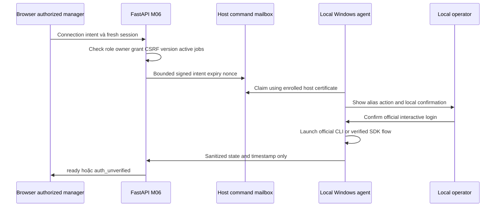

# Provider và account architecture

M06 control plane, M07 invocation adapters, M13 credential/desktop agent. [Queue](job-orchestration.md) kiểm retry/lease/fence; [security](security-design.md) bảo vệ secret và consent; [adapter design](legacy-adapter-design.md) đối chiếu hàm gốc. Chưa chạy CLI/SDK/bridge/login/model discovery/live test; không đọc credential/token/cookies.

## Hai pool độc lập

| Thuộc tính | Codex pool | SIWC pool |
|---|---|---|
| Public alias | C1…C9 trong một org, account UUID khác alias | SIWC-01…SIWC-09, account UUID namespace provider riêng |
| Legacy mapping | Dynamic `acct_*` pool và C1–C9 extension khác mô hình; cần mapping explicit approved, không suy từ số thứ tự/tên | Stable chosen account theo fixed/balanced job-key SHA; không cùng pool với Codex |
| Runtime | Official installed CLI trong Windows host, JSONL/text/schema adapter | Python/Node adapter + SDK/bridge có build/version riêng; không assume CLI parity |
| Credentials | Host-bound CODEX_HOME/profile alias với ACL; official storage config reviewed, keyring hoặc profile file theo verified CLI support | DPAPI CurrentUser/SDK storage ở Windows-user agent; local CLI vendored và multi bridge ngoài repo là hai connector khác nhau |
| Text | Caption automatic dùng Codex baseline; Node2/B3 configurable Codex | Node2/B3 optional sau capability test; Caption mặc định không chuyển SIWC |
| Structured | CLI output-schema + app semantic validation | JSON object+schema validation do adapter; native schema enforcement không giả định có |
| Images | Native imagegen là capability **runtime-gated**, không suy từ text success | Disabled capability native_imagegen until explicitly demonstrated SDK support; default manual upload hoặc Codex image adapter |
| Browser/video | Codex không phải Grok account; Grok own profile adapter | SIWC text success không mở khóa Grok/website |
| Concurrency | Per-account verified cap (default1), scheduler FIFO/fair eligible initial assignment; host/text limits và all request budget | V1 installation global1 SIWC request cho tất cả workspaces/accounts; account pin và host profile exclusive; không09requests song song |
| Failure | classifier + same-profile status diagnosis, usage/capacity/network typed | Envelope account mismatch/empty/nonJSON/bridge/SDK errors; unknown error không giả auth-expired |

No raw OAuth, Codex auth JSON, password/OTP, browser storage state/cookies trong Mongo/frontend. Metadata AccountDTO chỉ alias/state/capability/observed/model flags; secretRefAlias trong internal DB là opaque profile slot, chỉ local agent map path. Không REST upload credential file, password form hay endpoint reveal TOTP. F20 vault management được giữ ở host-only local operator path; deliberate deviation được ghi trong [decisions](decisions.md).

## Binding, assignment và không né giới hạn dịch vụ

1. Khi run được tạo, user chọn provider/model và fixed alias, hoặc `balanced_initial` trong **owner-granted** pool. M06 xác nhận ownerUser/host/org/workspace grant, positive health/capability và trần entitlement đã xác minh. Assignment dựa tải trước inference đầu tiên; không tự đổi tài khoản sau lỗi/quota. Primary/fallback live test chỉ diagnostic, không auto change production model.
2. Ghim binding theo `(run,stage-family)`; Caption cố định Codex, Node2/B3 theo frozen selection, B4 Codex-image/upload, Grok/site/Sheets profile riêng. Account pin giữ qua request retries/chapter resume/Windows restart. Initial balanced SIWC có thể hash stable run+stage-family trong list ordered snapshot, không tính lại từ pool thay đổi. Không re-hash sang alias khác khi account tắt.
3. Trước first invocation ghi requested binding; per-attempt ghi actual provider/account/host/model evidence. `modelRequested`, `modelResolved`, evidence `event|request|config|unknown` khác nhau. CLI config model chỉ là bằng chứng cấu hình, không khẳng định server model đã dùng; unavailable actual model để absent + unknown, không copy UI label vào actual. Worker phải verify envelope account đúng assigned; mismatch→ACCOUNT_MISMATCH/needs_reconciliation, output quarantine.
4. USAGE_LIMITED: blocked cùng alias, thời hạn quota evidence tuyệt đối mới là retryAt. Clock-only hint không suy ngày; local600s cooldown bảo thủ chỉ chặn burst, không chứng minh quota reset. Hết local cooldown **không** trigger switch, không tự test qua09profiles. Auth expired cần local re-login cùng profile, status positive rồi explicit resume. Account disabled/host offline cũng không automatic relocation.
5. Manual rebind chỉ khi owner có quyền/entitlement hợp pháp, reason không nhằm vượt quota, active/ambiguous work đã reconcile/abandon và operator approval có evidence. Tạo new workflow run/binding provenance; no silent rewrite old attempts; service/organization aggregate limits vẫn áp dụng. Block rebind nếu reason là “account hết quota dùng account khác để chạy tiếp” hoặc quota restriction chưa được giải quyết. Không có chức năng xoay account để circumvent service limits.
6. User không được dùng account không có grant dù đoán được alias. Credential manager không tự infer ownership từ login email/plan; onboarding mapping actor/owner/host có audit và local confirmation. Log/copy/download không lộ identity email/account details ngoài granted metadata.

## Connection và login flow

Intent window2phút to claim, interactive login deadline10phút, process ownership exclusive profile lease. Browser máy khác chỉ thấy “chờ thao tác trên host”; không stream OAuth redirects, QR/device codes hoặc authorization URL chứa token về frontend trong V1. UI có buttons Status/Connect/Disconnect/Models/Live test, mỗi loại side effect khác nhau. Connect/local setup không được xem ready trước positive session check cùng profile. Logout/disconnect cần drained account và confirm host+web; chỉ official logout của đúng profile, không delete arbitrary credential paths.

Nếu agent không có desktop hoặc SDK không hỗ trợ flow đã xác minh, trả LOCAL_OPERATOR_REQUIRED/UNSUPPORTED_FLOW; không PowerShell visible service Session0 hoặc keyboard automation nhập password/TOTP. DPAPI CurrentUser phải đúng service/logon user; sau logoff worker text có thể giữ headless capability chỉ nếu runtime+credential store đã kiểm; không giả browser/SDK vẫn hoạt động. Host ACL/env per-process không sửa global CODEX_HOME của user khác.

## Diagnostics và error contract

| ErrorCode mới | Evidence minimum | UX / recovery |
|---|---|---|
| AUTH_EXPIRED | Official same-profile status/SDK typed expiry, not text substring duy nhất | Block, local reconnect cùng account; không rotate |
| AUTH_UNVERIFIED | exec auth-like error nhưng status timeout/unknown hoặc còn logged-in | Không ép login/reset, show diagnostic; wait operator |
| USAGE_LIMITED | Typed limit hoặc known provider banner xác minh, absolute reset optional | Block cùng account; quota hint sanitized, no auto new-account |
| MODEL_CAPACITY | Capacity-specific evidence | Bounded same model retry, không quota-gate; chọn model khác phải new command sau budget policy |
| NETWORK_ERROR | Proven transport failure; media check submission receipt trước | Same-binding text retry; media unknown outcome→reconcile |
| WORKER_FAILURE | Spawn/dependency/process exit/boot/bridge failure | Không nói session expired khi thiếu evidence; supervisor diagnostics |
| CAPABILITY_UNSUPPORTED | Missing native imagegen/schema/runtime capability/SDK not built | Disable task path, offer manual/external import |
| ACCOUNT_MISMATCH | Response account !=assigned (typed envelope) | Security/lineage quarantine, operator review |
| CONTENT_REJECTED | Explicit content moderation evidence, distinguish save filesystem policy | Change/apply prompt version one-shot; no auto resend unchanged |
| IMAGE_SAVE_BLOCKED / ARTIFACT_MISSING | Native event evidence nhưng workspace save/artifact chưa verified | recover-only/local artifact attach, không sinh mới |

Legacy raw exceptions→stable typed error + safe evidence ID. Classifier ordering usage/auth/transport theo known patterns nhưng live-status positive giữ auth_unverified thay force logout. SIWC RuntimeError chung là `SDK_ERROR_UNCLASSIFIED` category worker until verified mapping; no claim token refresh support chỉ vì wrapper gọi getSession. Driver raw stdout/stderr không đưa API/events, local debug restricted/redacted14ngày.

Live quota/status/model tests: default monitors off; manual `status` không prompt, `models` có network nhưng không inference nếu connector contract verified, `live_test` **gửi inference** cần explicit confirm/grant/permit/budget and same binding. Primary/fallback diagnostic có thể dùng authorized models của cùng account chỉ khi user đã yêu cầu; fallback result không clear primary cooldown. Primary success chỉ gỡ gate cũ nếu compare-and-set vẫn cùng observed gate version. Scheduled live test nếu bổ sung sau phải opt-in riêng, không tự bật do load UI/login. No actual tests trong Phase02.

## SDK runtime verification gates

U01 account/model mapping: mock configs + sanitized CLI event/config provenance; trước native enable cần operator chứng minh alias đúng host/user và model evidence. U02 SIWC: audit exact bridge build/hash, client registration/host ID/scopes/session lifecycle/expiry/reset/concurrency/envelope, JSON validation và supported models bằng controlled test **ở phase được cho phép sau này**. Tài liệu SIWC official nêu plan usage tùy chọn cho eligible requests; không xác nhận SDK local cũ hay mọi hosting/entitlement. Không mở rộng token-sharing implementation/copy OAuth internals từ suy đoán. Xem [official source list](decisions.md).

Fallback khi U02 không đạt: SIWC disabled rõ lý do; Codex text nếu được owner cấp và capability đã kiểm, hoặc manual Web copy/paste; không covert provider fallback trong cùng job. U03 browser DOM và U05 native-image runtime chưa xác minh: upload approved image/video/external MP4 và local frame/merge; preserve parity mapping nhưng runtime badge “blocked pending verification”. U05 executable/version isolation: pin tested package versions, audit selected source dependency closure; missing binary fail before inference. Không cài packages/SDK hay đọc token trong Phase02.
