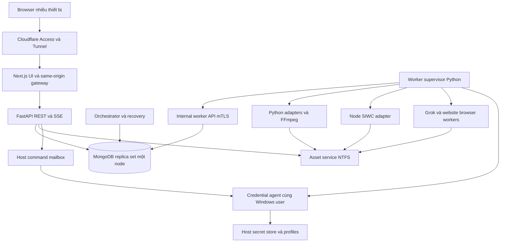

# Story Tool Web V1 — System design

Baseline: Phase01 commit `93a8dd7a4de82f152afc8d9f13598a1c10e9a571`; thiết kế ngày 2026-10-28. Đã đọc sáu tài liệu [inventory](../legacy-audit/feature-inventory.md), [modules](../legacy-audit/module-map.md), [flow](../legacy-audit/data-flow.md), [UI](../legacy-audit/ui-inventory.md), [risks](../legacy-audit/risk-register.md), [parity](../acceptance/parity-matrix.md). Đây là đặc tả, không phải runtime test; chưa tạo source/runtime/config triển khai.

## Kiến trúc được chọn

Một Windows host chạy Next.js/React/TypeScript UI và gateway cùng origin, FastAPI modular monolith, MongoDB Community single-node replica set, supervisor Python, workers Python/Node và credential agent tương tác trên desktop Windows. Cloudflare Tunnel + Access bảo vệ toàn hostname. MongoDB queue là nguồn bền vững, không Redis trong V1. NTFS asset store ngoài checkout giữ media/checkpoint bytes; MongoDB giữ metadata và các giao dịch. [Decisions](decisions.md) giải thích lựa chọn, nguồn chính thức và khác biệt parity.

Mọi đường tới MongoDB trong diagram là backend/control-plane; browser/worker child không được cấp DB credentials. Cùng host workers trao asset qua local spool rồi submit manifest qua internal API; hình minh họa worker→asset là I/O data-plane được kiểm soát, không quyền sửa pointer canonical. Tiến trình web không giữ credential provider. Tunnel chỉ route Next origin, không route MongoDB, internal worker API, CDP, Codex hay SIWC bridge.

## Module registry đích

Mã Mxx là boundary logic, **chưa phải file/folder source tồn tại**. API/domain không import Streamlit. Domain dùng ports/repositories, infrastructure triển khai ports. UI chỉ phụ thuộc public contracts, workers chỉ phụ thuộc versioned task envelope.

| Module | Trách nhiệm / quyền ghi | Dependencies được phép |
|---|---|---|
| M01 IdentityAccess | Access assertion validation, internal sessions, RBAC/membership, audit context | M15, Mongo repositories; không provider secrets |
| M02 WorkspaceCatalog | Workspace/date/root registration, archive view, monotonic Story display IDs | M01, M15, M16 |
| M03 StoryDomain | Story, revision, TYPE/Comment/Done, immutable LINK, output selection, manual text | M02, M04, M08, M09 |
| M04 PromptPolicy | Versioned bundles/TYPE maps, global migration, stage policies và validator profile | M15; prompt snapshot bất biến |
| M05 Orchestration | DAG, queue/leases/fences/slots, batch scheduling/fairness, retry/recovery | M03/M04 snapshots, M06 capabilities, M15 transactions |
| M06 ProviderControl | C1–C9/SIWC-01–09 metadata, account grants/affinity, connection intents | M01, M05, M13; không đọc vault |
| M07 WorkerAdapters | B1–B5 engines chọn lọc, capability negotiation, checkpoint compatibility | M05 envelope, M06 profile aliases, M08/M09 ports |
| M08 AssetStore | Upload chunks, hash/probe, immutable bytes, manifests, authorized download/GC | M01, M15, NTFS; không raw paths từ browser |
| M09 CheckpointLineage | Append-only checkpoint, validation, provenance, atomic promotion | M03 revisions, M05 fencing, M08 |
| M10 BatchAxcel | Excel/report/job-ID preview/import, global B1/B3 coordination, pool catalogs | M02–M05, M08; không tự spawn legacy worker |
| M11 PublishingExports | Website LINK/review, Sheets preview/export, local tracking; Facebook compatibility flag | M03/M05/M08, M13 browser/integration agent |
| M12 QueryRealtime | Status/history projections, Story Queue, SSE replay, user UI prefs/copy ACK | M01 filtered reads, job_events; không dispatch khi GET |
| M13 WindowsHost | Services/logon workers, credential mailbox/agent, browser ownership, FFmpeg probes | Internal authenticated API; child command allowlist |
| M14 Migration | Discovery/dry-run/versioned import/reconcile/rollback tool contracts | M02/M08/M09, read-only snapshot; không production source writes |
| M15 PersistenceAudit | Mongo validators/repos/transaction runner, idempotency, retention/audit | M01 context; không generic public DB query |
| M16 Operations | Health/readiness, maintenance barrier, backup/restore, host lifecycle | M13/M15; read-only status cho operator, OS changes local admin |

Dependencies trong bảng là contracts/ports hoặc immutable IDs/snapshots, không cho phép circular Python imports. Thứ tự triển khai: shared typed contracts và pure domain rules → application command/query handlers → repository/provider/host ports → infrastructure adapters; FastAPI composition root inject implementations. M05 đọc Story/provider snapshots qua ports, M03/M06 phát domain events hoặc nhận orchestrator commands qua handlers, không import ngược implementation M05. M09 validation thuần và promotion command cùng UnitOfWork M15, không gọi đệ quy M03↔M05. M15 nhận immutable identity context từ handler thay import authentication middleware M01. Không domain module nào tự commit transaction riêng trong một command đang atomic.

## Canonical workflows

New Story → resolve TYPE/prompt version → immutable revision → workflow run → durable jobs: caption → content_rewrite → visual_prompts → hai nhánh `plan → chapter1…5 → story_assemble` và `opening_image → clip1 → last_frame → clip2 → merge`. Job điều phối không giữ provider slot lúc chờ dependency. B3 resume thực hiện một chapter/invocation để nhường slot; opening-image và B5 dùng media lane riêng. See [orchestration](job-orchestration.md), [adapter contracts](legacy-adapter-design.md).

Caption automatic 650–800/footer; Leader5 850–1.150/chapter, 4.500–5.500 tổng thân; manual validator riêng; historical 6-act/long Leader5 chỉ compatibility read. Video plan dual10, option stop-after-clip1 không đánh merged complete. Aspect hiện tại any/decodeable, merge normalize 720×1280/30fps. Các validator này được gắn version để không bị UI text cũ thay thế. Axcel B2=N/A, B1 Caption→B3; MP4 import và frame0 không Grok. External final bỏ sinh Grok. Website publish có preview+confirmation, serialization theo site profile; LINK write-once. Facebook backend compatibility có feature flag off, không tự chạy lại publisher cũ.

Status mặc định là grid + detail/results; History truy vấn cùng projection, không tái dựng menu legacy đã ẩn. Story Queue đếm mỗi Story một lần, Axcel B1+B3 và Grok B1–B5, pending khác queued. Start/Retry trong queue điều khiển Axcel global text, không mặc nhiên scheduler Grok. React route/modal state gắn workspace/revision, SSE không tháo modal; clipboard ACK khác job success. Prompt global chỉ sau migration preview/confirm.

## Process lifecycle trên Windows

| Tiến trình | Identity / startup | Failure/shutdown |
|---|---|---|
| mongod replica set | Windows service riêng, non-admin, loopback, authorization/internal auth; db path ngoài repo | Mất primary → API readiness false, không claim/submit; service recovery bounded, không tự reset DB |
| FastAPI + orchestrator | Hai service tiến trình riêng; API nhiều instance được, orchestrator có leader lease + transaction fences | Stop admission, drain; API restart không đổi job ownership; orchestrator leader mất vẫn chống dispatch trùng |
| Next gateway | Service sau API readiness; không Next filesystem static serving media | Forward SSE streaming/backpressure; gateway fail không kill workers; reconnect bằng cursor |
| cloudflared | Service riêng, named tunnel, chỉ Next loopback | Tunnel down làm remote UI offline; workers không phụ thuộc tunnel; không restart inference |
| Supervisor headless | Windows service user không admin; local media/FFmpeg tasks | Boot_id mới sau restart; heartbeat và revoke enrollment khi cert mất; bounded restart5lần/10phút rồi cần operator |
| Browser/SIWC/credential agent | Scheduled task “at logon”, đúng Windows user, desktop unlocked khi thao tác cần UI; không service Session0 để giả browser login | Logoff/locked desktop khi cần UI → capability offline/awaiting_operator; không tự login hoặc tự nhập OTP |
| Child engine | Supervisor tạo Windows Job Object cho process tree; argv allowlist, task-private env/cwd | Grace cancel30s tại safe point; kill tree đã sở hữu nếu cần, remote submission chuyển ambiguous; không kill browser tabs/process của user khác |

Boot order: DB primary+indexes+schema → API health → orchestrator/supervisor enrollment → Next/tunnel → interactive agent lúc logon. Health không mở CLI/session hay gửi test prompt. Shutdown/Windows update: maintenance admission off, pause schedulers, finish safe tasks hoặc mark reconcile, journal submissions, stop own children; sau reboot không tự retry external work chưa rõ kết quả. [Security](security-design.md) định nghĩa host identities và ports.

## Deployment envelope và vận hành

V1 một organization, nhiều users/workspaces có membership; schema orgId từ đầu để ngăn access chéo. Multi-device nghĩa nhiều browser tới **một** host, không phải UI giữ local paths hay tự chạy AI trên máy client. Mỗi máy client upload/download qua API; không truyền đường dẫn ổ F/E của browser. Proposed storage root do local admin chọn trên NTFS riêng, không dùng production legacy root, không junction. Data paths là opaque IDs trong API.

Initial planning budget (chưa benchmark): 10 concurrent browsers, 10k Stories/workspace, 100 queued tasks, text lane8/GPT6/Grok2 (trần operator/provider còn nhỏ hơn), API page size≤200, SSE≤3/user/30org. Asset chunks8MiB; MP4 tới8GiB nếu disk quota cho phép; không gửi media nguyên khối qua gateway JSON. Disk free <max(10GiB,10%) dừng admission media; UI có storage warning. Input limit140k chars; job event message≤2KiB sanitized; không unbounded embeds. Performance gates Phase03: fake providers queue claim contention, refresh latency p95≤2s với10client và asset stream không chặn heartbeat. Đây là mục tiêu, chưa đo.

Logs: requestId/jobId/attemptId/fence/hostId/bootId + stable error, không prompt/token/cookie/path secrets. Progress có actual count/phase, percent heuristic phải ghi provenance; system readiness/worker freshness/queue age/blocked/ambiguous/storage usage/backup-age thành metrics. Build/schema/adapter/validator versions được pin trong run.

## Mở rộng worker hosts

Giữ control plane tập trung; host thứ hai enroll bằng mTLS, advertise capabilities/storage/account aliases, chỉ pull qua internal API trên private network. Không mở MongoDB trực tiếp cho worker remote. Account/session vẫn host-bound; không copy DPAPI/CLI home giữa host. Asset upload/download content-addressed qua scoped internal API thay SMB shared working directory. Fencing không dựa PID host khác. Runtime compatibility và quorum DB nếu muốn HA là phase riêng: single-node replica set không tạo HA, không cho hai control planes tách DB tự nhận một workflow. Chỉ tăng capacity sau khi kiểm chứng provider entitlement và race tests; không chuyển account để né giới hạn.

## Cổng Phase03

Thiết kế đã chọn các defaults có thể review; không chứng minh môi trường Windows/SDK ready. [Decisions](decisions.md) tách hồ sơ cần duyệt; [migration plan](../migration/migration-plan.md) định nghĩa no-overlap/cutover và rollback. Phase03 chỉ bắt đầu khi user yêu cầu, phạm vi scaffold/mock được chốt; production/live-provider vẫn bị khóa bởi U01–U09 và acceptance tương ứng.
