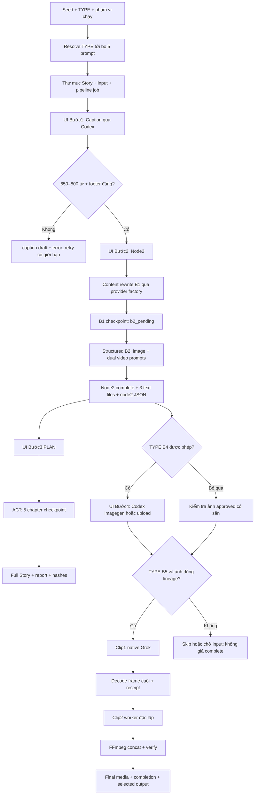
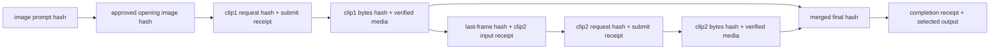
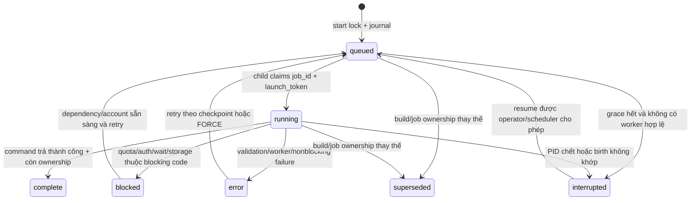

# Data flow và mô hình lưu trữ legacy

Phân tích tĩnh 2026-10-28. Sxx tham chiếu [module map](module-map.md); Fxx tham chiếu [feature inventory](feature-inventory.md). Tên file trong sơ đồ là hợp đồng được đọc từ code, không phải dữ liệu Story đã được sao chép. Không chạy generation, worker, database migration hay kết nối mạng.

## Luồng chuẩn và tên bước

S01 → S07 → S02 là đường khởi chạy. Sau Node2, B3 có thể chạy song song B4→B5 (S02). Chế độ caption/node2 dừng tại checkpoint tương ứng. Có trường hợp parent pipeline xong khâu khởi động trong khi worker con còn chạy; trạng thái UI phải reconcile job con và output, không chỉ đọc parent.

**Phân biệt thuật ngữ:** UI Bước1 gọi là B1 ở nhiều nhãn mới nhưng thực chất tạo Caption; Content B1 và prompt B2 là hai pha nội bộ Node2/UI Bước2. Axcel dùng Caption B1 làm nguồn B3 và đánh dấu B2 N/A. Không tạo API schema dựa riêng vào nhãn “B1”.

## Hợp đồng text, PLAN/ACT và resume

| Pha | Đọc / xác minh | Ghi / điểm commit | Retry/khôi phục |
|---|---|---|---|
| Caption (S03) | seed không rỗng; placeholder INPUT; attempts 1–10 | caption hợp lệ hoặc caption_draft; metadata count/valid/attempts | Rewrite toàn bộ caption bằng lỗi count/footer; draft không được làm input Node2 |
| Content B1 (S04) | Caption phải qua caption_ok; placeholder CAPTION | content + node2_status=b2_pending ngay sau B1 đạt | Reuse content validated + b1_attempts khi B2 chưa xong; không tiêu lượt viết B1 lại |
| Visual B2 (S04) | CONTENT placeholder; object đúng hai khóa; 9:16; dual markers và 5 mốc/clip 0–2…8–10s đúng thứ tự/không trùng; không timeline >10s | content/video_prompt/image_prompt + node2 JSON + node2_status=complete | Structured retry; đọc text và metadata khi load, kiểm tra content với node2 JSON trước B3 |
| PLAN (S05→S06) | Source content contract; TYPE templates; CONTENT, PLAN, ACT_NUMBER, ACT_BEAT, PREVIOUS_PARTS đúng pha; schema 5 beats/titles | story_plan chứa format/content_sha256/prompts_sha256/plan | Plan đã có phải khớp hash/format; prompt 6 hồi bị chặn; không âm thầm xóa plan cũ |
| ACT (S06) | 5 chapter, word budget động để còn đủ 4.500–5.500 từ, first-person heuristic, không footer/code fence/heading thừa | node3_parts/part_NN.md khi đạt; draft riêng khi không đạt; metadata progress | Duyệt/check từng part đã lưu; tiếp tục part thiếu; chapter 2+ được b3_resume soft priority nếu đã có chapter hợp lệ |
| Hoàn tất B3 (S06) | Ghép heading CHAPTER 1–5/codes 916, Phap916; validate full story; word count phần thân | full_story text/Markdown, leader copy, node3 report, node3_status complete | Loader hỗ trợ historical completed formats; mismatch source bị chặn trừ flag bảo toàn snapshot sau FORCE step2; retry B3 bỏ flag đó |

Validator kiểm tra được word count, schema, marker và heuristic ngôi kể; không chứng minh chất lượng nghệ thuật, continuity, twist hay cliffhanger thật sự. Đây là giới hạn phải giữ trong ca nghiệm thu.

## Provider, account, model và tài nguyên đồng thời

| Luồng | Routing/model | Scope giới hạn | Failure/recovery |
|---|---|---|---|
| Caption pipeline | S02 tạo CodexRunner trực tiếp | Default file slots hoặc Codex pool | Không tự chuyển Caption sang SIWC vì chọn SIWC cho Node2/B3 |
| Node2/B3 | S11 enabled: env STORY_TEXT_PROVIDER ưu tiên, nếu không dùng config SIWC enabled | Phụ thuộc runner thực; job ghi text_provider_actual/text_model_actual/text_account_actual khi có | Lựa chọn settings là intent; metadata persisted và CLI response mới là bằng chứng actual |
| Codex text | S08 exec không truyền model riêng; profile CLI config quyết định; schema qua --output-schema | Default concurrency env mặc định 2, clamp 1–4, file locks dưới app runtime | Auth kiểm tra cùng CODEX_HOME; thiếu CLI, launch/timeout/empty/JSON tách lỗi |
| Codex pool động | S09 chọn enabled/auth-ready/không cooldown/exclude; CODEX_HOME riêng/account; max_jobs clamp 1–16 | SQLite leases/waiters/stats/priority ở app pool; FIFO eligible account; cân bằng tỉ lệ busy/cap, dispatch/cap; priority burst ≤2 | Release sau request; stale PID birth cleanup; pool wait mặc định 240 phút, clamp 30 phút–12h tại runner; DB lỗi không cho vượt slot |
| C1–C9 extension | S10 quản lý root/profile/credential riêng bằng CLI; không đủ bằng chứng đồng nhất với ID pool động | Cấu hình extension khác pool config; không tự gom thành một scheduler | Official interactive login; keyring/TOTP và auth files không sao chép; mapping actual còn cần test giả |
| SIWC | S11 model env/config, default slug trong code; S12 fixed hoặc balanced SHA(job_key) qua 9 account | 1 FileLock chung Windows-user/local-app, không theo Data Folder, không 9 request song song | Job/account pin, không đổi identity khi quota/auth lỗi; envelope account mismatch/empty/invalid JSON bị chặn; SDK bên ngoài chưa audit |
| B4 Codex image | S14→S15 sử dụng native imagegen/events/artifact collector | Media input lock + Codex slot/pool + Excel step4 gate nếu là Excel | Không áp text transport retry một cách suy diễn cho ảnh; ledger/receipts quyết định có được sinh mới |
| B5 Grok | Approved input hash → native UI, browser profile/CDP, worker clip riêng | Media/run/stage locks + Excel step5 gate; không thấy distributed host limit | Submit receipt chống trùng; media tải muộn có reconcile; browser login/manual hold khác auth Codex |
| Excel scheduler | Batch concurrency, scheduling Excel/TYPE/multi_queue | Một scheduler lock/batch; stage4/5 lease riêng/data root; 0 gate limit=unlimited | Pause cấp mới; jobs cũ tiếp tục; imports chưa hoàn tất bị chặn |
| Axcel global text | Snapshot config TYPE cho B1/B3; preflight nền | Run_id/lock và capacity helpers; MAX_RETRY_FAILURES=3 | Stop không phá completed/checkpoint; retry hữu hạn; trạng thái scan phải tách generation |
| Website | Queue pump → runner → worker, selectors/profile | Một queue pump/data root, xử lý một job/lần | Preflight lại lúc dequeue; không retry failed/posted_needs_link tự động |

Codex transport: tối đa hai retry (2s, 5s); model capacity: tối đa ba retry (10s, 30s, 60s), không ghi quota gate. Account usage/auth mới đủ điều kiện failover; auth_unverified/codex_error/timeout không tự đổi account theo suy đoán. Clock-only reset giữ hint, pool dùng cooldown tạm 600s; không tự gán ngày/múi giờ. Đây là hợp đồng mã hiện tại, không phải đề xuất chính sách mới.

## Luồng B4/B5 và lineage

1. S14 nhận prompt, ảnh upload hoặc Codex native artifact. Pointer input chứa prompt hash, bytes hash và signature. Ảnh thay đổi được lưu history, đánh video stale; cùng bytes không làm hỏng receipt stat-bound.
2. S15 `approved_image` kiểm tra pointer không thoát Story root, file thật, hash và decoder/quality. Các nhãn “9:16” trong UI không thay thế quy tắc validator hiện tại ở S18/S23.
3. S17 tạo run root theo request hash. Thay opening image/overwrite archive run trước; không reuse checkpoint khác prompt/reference. FFmpeg readiness được kiểm tra trước generation.
4. Clip1 được verify bằng probe và decode tail. S18 lấy frame cuối hiển thị, không giả bằng ảnh mở đầu. Frame có hash và input receipt để mở khóa clip2.
5. Clip2 dùng frame+prompt riêng, native worker/tab riêng. Những helper/shared-CDP comment cũ trong module không phải bằng chứng phải giữ browser object clip1 sống. Media clip2 cũ chưa đạt được đưa retry_history khi retry.
6. S18 kiểm tra duration khoảng target ±max(1.5s,20%), tỷ lệ video informational, decode phần cuối. Merge giữ độ dài clip thật, normalize 720×1280/30fps, audio AAC stereo hoặc silence rồi concat; verify final trước publish completion. Không loop clip ngắn để giả đủ 20s.
7. S17/S23/result helpers xác định file hiện tại từ checkpoint/hash/manifest/completion/stale state. Parent exit code hoặc file có đuôi mp4 không đủ.
8. Retry clip1 làm stale reference/clip2/final; retry reference giữ clip1; retry clip2 giữ clip1/frame; merge-only không gọi Grok. Import manual cũng phải qua validation.

## Các luồng thay thế thực sự tồn tại

| Luồng | Call chain và output | Điểm khác biệt bắt buộc |
|---|---|---|
| External video (F31) | S42 import/attach → video final + frame0 + pointer/receipt; S02 short-circuit Grok | Frame đầu khác frame cuối clip1; external verified là final, không Grok checkpoint; attach có backup/rollback và chặn active media worker |
| Axcel (F43–F46) | S47 install wrappers → Excel-first/report job-ID bridge S48 → MP4 scan/import → S46; text S49 → Caption/B3 | B2 N/A; mapping job/prompt/file explicit; nguồn MP4 không xóa; B4 frame recovery và B5 import độc lập với Grok |
| Manual Web (F48) | Pro dispatcher cuối → S56 handle cuối → prompt/validate/save → text/metadata/report/backups | V3.2 draft_get/index không còn workflow cũ; direct-save cho phép version rỗng có chủ đích; validator relaxed khác AI strict; không gọi model |
| Website/LINK (F49–F52) | LINK event → S53 → S52 preview/queue → S54 → visibility runner → S55 → S50/S34 guarded writer | Confirmation cho publish, B3/image/link preflight; state posted_needs_link không có nghĩa được post lại; LINK mới cùng host/public/path916, existing bất biến |
| Facebook legacy (F53–F54) | Store + UI + Graph client + worker còn source | App đã bỏ auto runner; group/page/content-source/type round robin, schedule/reservation, bulk recovery, comment retry và manual-published cần preserve để đối chiếu nhưng không tự kích hoạt |

## Storage theo scope

| Scope / chủ sở hữu | Tên schema/file từ code | Nội dung và ý nghĩa | Khôi phục / lưu ý |
|---|---|---|---|
| Cấu hình người dùng/máy | data_folder config qua config_dir; prompt global files; status folders/workspace prefs | Pointer active Data Folder; prompt libraries và mapping theo root; folder history | Không đọc giá trị thật. Scope local-user không tương đương tenant/user trên web |
| App root/runtime | .runtime Codex usage block/slot locks; browser/tunnel state | Gate tạm, browser process/config/calibration, runtime process bookkeeping | Không đồng bộ PID/locks sang host khác; không đọc raw runtime |
| Codex account pool | pool config + homes + SQLite leases/waiters/account_stats/priority state | Account enabled/capacity, homes, dispatch fairness/cooldowns | Tách secret vault/auth khỏi metadata pool; không chuyển file auth sang client |
| SIWC | .siwc_provider config + bridge SDK ngoài repo + Windows-user DPAPI state | Provider/model/fixed/balanced selection và session account | Không đọc hoặc xuất DPAPI blobs; nguồn bridge/session lifecycle là điểm U |
| Data root | story_NNN dirs; _trash; story_history.sqlite3 | Immutable ID namespace; history index và sheet_export_log | next ID xét folders, trash và history, không lấp ID đã xóa; mkdir race retry |
| Data root UI | .story_ui_state.sqlite3 với ui_state/ui_meta; UI JSON đời trước | Visible columns, Quick Copy fields, stage limits, migrations | SQLite là durable prefs; session_state là mirror; root switch phải clear widget keys |
| Data root policy/batch | .excel_type_stage_policy.json; .excel_stage_gates.sqlite3; batch manifests/locks/tracking | TYPE step4/5 flags, stage_leases, rows/import journal/scheduler | Default allow và limit 0 phải đúng; DB lỗi fail closed; batch import pending không runnable |
| Story text | input.txt, caption.txt/caption_draft.txt, content.txt, image_prompt.txt, video_prompt.txt, node2.json | Text pipeline checkpoints | content độc lập checkpoint B1; chỉ node2 complete mới là đầu vào chuẩn B3 |
| Story metadata | metadata.json; TYPE/LINK/Comment/completion files theo store modules | Stage/count/hash/provider/source/config hints, user choices | update_metadata dùng .metadata.lock + atomic replace, an toàn giữa process trên cùng filesystem theo contract; vẫn phải audit các direct writer/operation nhiều file và multi-host; filename tồn tại không phải validation |
| Story jobs | .jobs/name.json; start/identity locks; stdout/stderr per job | job_id, launch_token, config, status, timestamps, spawn/worker PID+birth, logs, error diagnostics | Nonce là ownership identifier, không phải account credential; không sao chép log/config thực trong audit |
| Story B3 | story_plan.json; node3_parts/part_NN.md và draft; full_story.txt/.md; full_story_leader_copy.md; node3_report.json | Source/template hashes, format, plan, validated parts/final report; current story_plan schema đúng7 trường nhưng ràng buộc count5 nằm ở Python validator | Checkpoint khác hash/format bị chặn; historical formats đọc qua compatibility loader |
| Story B4 | image_chatgpt; chatgpt_opening_image.png; .mode2_opening_image.json; .mode2_image_checkpoint.json; gpt_image_progress.json; mode2_input_history | Native artifacts, pointer/source/hash, generation/recovery progress | Artifact collector và attempt ledger tránh sinh trùng; content rejected registry khác image-save-blocked |
| Story B5 | grok_agent_20s/request-prefix/checkpoint.json, clip stage folders, clip_01_last_frame.png, clip_02_input.json, video_20s.mp4 | Stage request/reference/bytes hashes, verification states, run completion | retry_history/archive giữ media; submit-once receipts + late download reconciliation; merge-only dùng local files |
| Story quality/selection | grok_agent_media_manifest.json; .agent_media_quality.json; .grok_agent_quality_policy.json; stale/completion/output-selection receipts | Candidate/primary media, cache signatures/version, selected clip/final/manual/external | Probe cache có version; readers cache-only, workflow mới verify bytes; pointer stale không complete |
| Story external | .mode2_external_video.json; mode2_external_video/imports.json; imported galleries | Video selected, original/transcoded media, frame0 receipt | Atomic attach/rollback, giữ upload khi lỗi |
| Axcel | provider/manifest files; axcel_import.xlsx; axcel_job_mapping.json; axcel_job_import_run.json; MP4-folder config; axcel_video/final_video.mp4 + import metadata | Batch enrollment, report mapping, scan tokens, import/source hashes, B4 frame/B5 output | Report-map restore; không tự match filename mơ hồ; giữ nguồn và mapping cũ |
| Axcel global text | global_text_run.json; global_text_type_configs.json; global_text_configs.json | Preflight progress, prompt snapshot, run_id/stop/retry counters | Race run_id được kiểm tra; cấu hình prompt cũ không được thay bằng mapping mới giữa run |
| Website | S50 state_dir DB jobs + site_config; worker.log; browser/test screenshots; cell notes | Queue/status/hash/tries/stage/url/error, selectors, job diagnostics | Queued→running→done/failed/posted_needs_link; abandoned/worker_exit phải reconcile, không post lại tự động |
| Facebook legacy | publisher.sqlite3 và tables pages/groups/jobs/attempts/settings/distribution/content sources | Schedule/Page credentials reference, hashes, media/comment publish recovery | DPAPI secrets không audit; local timestamps/slot reservation và external remote state cần đối soát |
| Story pools/media vault | Workspace DB, STORY_POOLS/MEDIA/type/hash.mp4, daily root, pool_source metadata | Content/video dedupe và matching theo TYPE/ngày | Preview fingerprint, unmatched matching; hidden panel không đồng nghĩa dữ liệu bị xóa |
| Exports | tracking XLSX, text/md/json/media downloads; sheet_export_log | Snapshot/local exports và remote append/update/skip bookkeeping | Remote Sheets đã ghi nhưng local log lỗi là ambiguous, cần reconcile theo plan/fingerprint |

Tên cụ thể của tất cả helper/path builder, SQL owner và imports có trong [chỉ mục module](module-map.md), tránh suy diễn từ một layout dữ liệu mẫu. Không tạo sample Story hay mở SQLite thực để “xác nhận” schema.

## Job state machine và khôi phục

`spawn_pid` không có quyền sở hữu job. `worker_pid` và birth time mới được dùng để nhận diện tiến trình. `save_job` fsync + replace/retry; fallback ghi trực tiếp khi Windows file locking kéo dài là một điểm có thể cho reader thấy JSON dở. Các reader synchronization-critical dùng uncached; UI dùng mtime/size cache. Flags operator Done/copy/link không thuộc state machine worker.

## Những gì Web App phải kiểm thử tương đương

Mỗi Fxx có Txx trong [parity matrix](../acceptance/parity-matrix.md). Tối thiểu phải bao phủ replay event, hai client cùng sửa, crash sau remote submit nhưng trước checkpoint, job bị thay ownership, source/prompt hash đổi, root switch, media cùng bytes nhưng filename khác, DB khóa/hỏng và session hết hạn. Chỉ mock/fixture được dùng cho Phase01; các test Web App này mới là đặc tả, chưa có code web để chạy.

## Chi tiết scheduler, fast-output và review

- Excel có ba mode: excel (mặc định cho batch cũ), balanced_type, weighted_type. Balanced chọn score (launch_count, active_count, thứ tự TYPE xuất hiện); weighted dùng ((launch_count+1)/weight, active_count, thứ tự TYPE). Giữ thứ tự row bên trong TYPE. TYPE concurrency cap0–30 được xét trước, allow_spillover mặc định true có thể dùng slot global còn rỗi khi mọi TYPE pending đều chạm cap. Weights hợp lệ >0, clamp tối đa1000; unknown mode trở về excel.
- Smart retry lấy required steps từ stop_after/run_node3/run_grok và TYPE flags; auto chọn bước required chưa complete sớm nhất. Category none/running/done/wait/fix/retry khác nhau, chỉ retry eligible mới launch. accept_config_fixed đổi fix→retry sau xác nhận; explicit manual retry ảnh bị từ chối khác vòng auto-repair. Auto-repair ảnh là opt-in one-shot request original/manual/auto; không global auto retry hay bypass policy.
- stop_after_clip1 là fast-output hiện tại: trả output clip1 verified, đánh clip1_only_complete và selected_output=clip1, merged complete=false; không trích frame, không tạo clip2, không merge. Tắt lựa chọn này để tiếp tục dual10 từ checkpoint. Clip2 hoàn tất vẫn được giữ khi chưa có clip1 local để merge; không tạo lại clip2 vì merge thiếu input.
- Website lưu queue ở _site_publisher/queue.sqlite3, review ở _site_publisher/link_reviews.sqlite3 (reviews: story_id, link_sha256, reviewed_utc). Review one kiểm expected hash; review_many tối đa1000, skip stale, ACK các hash còn đúng theo transaction. Review không viết/xóa LINK. Snapshot review có thể lazy-init DB: “read-only” ở UI có nghĩa không sinh job/media, không bảo đảm tuyệt đối0ghi metadata.
- Story Queue tổng hợp root không theo filter/batch: Axcel required B1+B3, Grok B1–B5; pending không phải queued. Nút Start/Retry hiện điều khiển global Axcel B1/B3, không tự biến thành scheduler Grok tổng quát. Workspace toolbar chỉ gọi controls gốc.
- Prompt global giữ legacy routing đến khi operator preview/confirm migration và flag enable xuất hiện; migration có conflict choice và rollback nhiều file. PROMPT_CONFIG là kho trung tâm workspace, không phải việc tự chuyển toàn bộ prompt sang config người dùng.

## Inventory error codes cố định trong adapters

Bảng trích các code hằng truyền vào error constructors/code keyword từ code hiện tại, không lấy raw_message hay log thật. Không coi ValueError/RuntimeError message tự do là stable code; wrapper có thể ánh xạ exception chung thành worker_error. Code động từ variable hoặc SDK ngoài repo không thể liệt kê chỉ bằng literal scan.

| Module | Code hằng phát hiện tại constructor |
|---|---|
| [codex_runner.py](<F:/AI CONTENT/SOURCES/IMG/story_tool_v2_1_GPT_IMAGE_EFFECT_FX97_FACEBOOK_BULK_RECOVERY/src/story_tool_mode2_v2_1_FX97_FACEBOOK_BULK_RECOVERY/codex_runner.py>) | `auth_unverified`, `codex_error`, `empty_response`, `launch_error`, `missing_cli`, `model_capacity`, `not_logged_in`, `queue_timeout`, `timeout`, `transport`, `usage_limit` |
| [codex_account_pool.py](<F:/AI CONTENT/SOURCES/IMG/story_tool_v2_1_GPT_IMAGE_EFFECT_FX97_FACEBOOK_BULK_RECOVERY/src/story_tool_mode2_v2_1_FX97_FACEBOOK_BULK_RECOVERY/codex_account_pool.py>) | Exception/variable path; xem module và state taxonomy |
| [chatgpt_image_engine.py](<F:/AI CONTENT/SOURCES/IMG/story_tool_v2_1_GPT_IMAGE_EFFECT_FX97_FACEBOOK_BULK_RECOVERY/src/story_tool_mode2_v2_1_FX97_FACEBOOK_BULK_RECOVERY/chatgpt_image_engine.py>) | `content_rejected`, `image_save_blocked`, `invalid_image`, `launch_error`, `timeout` |
| [codex_artifact_collector.py](<F:/AI CONTENT/SOURCES/IMG/story_tool_v2_1_GPT_IMAGE_EFFECT_FX97_FACEBOOK_BULK_RECOVERY/src/story_tool_mode2_v2_1_FX97_FACEBOOK_BULK_RECOVERY/codex_artifact_collector.py>) | `ambiguous_artifact`, `artifact_changed` |
| [mode2_image_step.py](<F:/AI CONTENT/SOURCES/IMG/story_tool_v2_1_GPT_IMAGE_EFFECT_FX97_FACEBOOK_BULK_RECOVERY/src/story_tool_mode2_v2_1_FX97_FACEBOOK_BULK_RECOVERY/mode2_image_step.py>) | `artifact_missing`, `content_rejected`, `missing_input` |
| [grok_video_worker.py](<F:/AI CONTENT/SOURCES/IMG/story_tool_v2_1_GPT_IMAGE_EFFECT_FX97_FACEBOOK_BULK_RECOVERY/src/story_tool_mode2_v2_1_FX97_FACEBOOK_BULK_RECOVERY/grok_video_worker.py>) | Exception/variable path; xem module và state taxonomy |
| [grok_agent_engine.py](<F:/AI CONTENT/SOURCES/IMG/story_tool_v2_1_GPT_IMAGE_EFFECT_FX97_FACEBOOK_BULK_RECOVERY/src/story_tool_mode2_v2_1_FX97_FACEBOOK_BULK_RECOVERY/grok_agent_engine.py>) | Exception/variable path; xem module và state taxonomy |
| [grok_web_engine.py](<F:/AI CONTENT/SOURCES/IMG/story_tool_v2_1_GPT_IMAGE_EFFECT_FX97_FACEBOOK_BULK_RECOVERY/src/story_tool_mode2_v2_1_FX97_FACEBOOK_BULK_RECOVERY/grok_web_engine.py>) | Exception/variable path; xem module và state taxonomy |

Job-level taxonomy: queued/running/complete, blocked với blocking codes, error với nonblocking/generic, interrupted theo liveness, superseded theo ownership/build. Image progress và video stage còn có verifying/verify_failed/browser_connect_failed/worker_failed/stale/partial; các state này không được trộn với auth/session. SIWC RuntimeError ở wrapper có thể thành worker_error chung dù message nhắc session; đây là giới hạn taxonomy hiện tại, không phải bằng chứng lỗi auth được typed như Codex.
