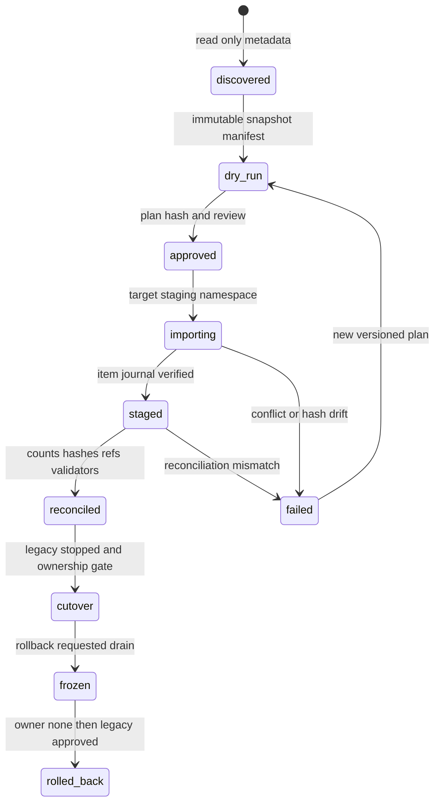

# Migration, compatibility và rollback plan

Thiết kế M14/M16, chưa discovery production data hay chạy import/backup/engine. Project legacy source chỉ đọc, không sửa/install/patch/start. Baseline source audit commit `93a8dd7a4de82f152afc8d9f13598a1c10e9a571`; data roots thật chưa được cung cấp/đọc. Chỉ local-admin registered source alias mới được discovery tương lai, không suy active data path từ source/config secrets. Phụ thuộc [database schema](../architecture/mongodb-schema.md), [adapters](../architecture/legacy-adapter-design.md), [queue](../architecture/job-orchestration.md), [security](../architecture/security-design.md), [decisions](../architecture/decisions.md).

## Bất biến ownership

Production workspace chỉ một engine owner ở mỗi thời điểm: `legacy → none/frozen → web`, hoặc rollback `web → none/frozen → legacy`. Mongo ownershipEpoch chặn Web jobs; legacy không hiểu Mongo fence nên **không thể** dựa một document để ngăn legacy chạy. Điều kiện cutover là operator dừng old schedulers/process trees, disable autostart/task/tunnel production admission theo thủ tục quản trị được phê duyệt, xác minh không còn actor khởi động cùng jobs/remote profile; operator attest + independent process/receipt inventory. Nếu không chứng minh được exclusivity, **không cutover**.

Không shared writable production folder, SQLite DB hay browser profile giữa hai app. Web dùng namespace/credential identities riêng sau entitlement/consent; không copy auth. Ngay cả folder khác cũng không đủ nếu cùng remote operation/Story được auto chạy cả hai: imported operation ledger mặc định hold và historical job IDs không trở thành runnable jobs. Parallel testing chỉ synthetic independent workspaces, fake providers/DOM và media tự tạo không liên quan production. Không mirror generation/publish thật để so output.

## Versioned phases và artifacts

| Phase | Hoạt động và input/output dự kiến | Safety/điều kiện qua cổng |
|---|---|---|
| MIG00 Source registration | Local admin chọn data-root alias, include allowlist Story/media/prompts/metadata/SQLite schema; assign discoveryId/org/workspace | Không credential/accounts/browser profiles/runtime auth/log dumps; reject source root==target hoặc ancestor/child/symlink; source checkout không phải target data |
| MIG01 Read-only discovery | Enumerate files/counters/formats/size/hash metadata; records manifest version1, per-file raw SHA,size,mtime,logical owner,format; no module imports/scripts | Allowlist chỉ data assets, no code execution; SQLite chỉ snapshot read-only source transaction/backup do authorized operator cung cấp, không mở live DB có WAL rồi copy main alone |
| MIG02 Freeze và snapshot | Operator legacy owner stop/drain; consistent data snapshot/copy sang read-only staging outside legacy root, manifest hashes; dump/copy cả DB/WAL consistent theo source protocol | Nếu producer không dừng, discovery chỉ advisory; mtime stable không chứng minh app đã stop. No Web admission. Không mutate files legacy để mark migrated |
| MIG03 Dry-run | Parser đọc snapshot, classify current/historical/manual/unknown, duplicate mapping, preview conversion plan và warnings; migrations+plan asset ở target only | No canonical publish, no runnable job, no provider calls; strict unknown quarantine; user approve exact plan/source hash/version |
| MIG04 Versioned import | `legacy_to_web_v1` migration, target namespace UUID mới; copy allowed bytes immutable, verify hashes, commit per-item journal chunks≤100/1MiB | Unique (migrationId,sourceRelativeKey,sourceHash); resume safe; imported workspaces admission=false; partial import not runnable; failed chunk không xóa completed bytes |
| MIG05 Reconciliation | Count/story IDs/refs/statuses/checkpoints/prompt choices + raw/text hashes; golden fixture comparison; signed report safe metadata | Không fake success từ legacy job complete; all mismatch disposition approved; no missing critical asset/reference/hash drift/ambiguous auto replay |
| MIG06 Controlled cutover | Backup target+source snapshot, recheck frozen source/no new writes, approve unresolved holds, ownershipEpoch++, active namespace pointer change atomic | Only frozen owner none→web; enable admission **selectively** capability/feature gates; old remote operations stay blocked/reconcile, user no blind retry-all |
| MIG07 Observation | Canary synthetic jobs first, approved new production tasks only after tests; event/queue/output/backup monitors, operator review | No simultaneous original production jobs; error thresholds stop new admission, preserve receipts; no auto rollback that starts legacy |
| MIG08 Rollback | Drain/freeze Web, reconcile remote side effects, export neutral handback package if required, owner none→legacy by operator | Không restore stale DB rồi auto re-post; original snapshot/root retained, new Web production work explicitly reconciled before handback |

Phases MIG là kế hoạch dữ liệu ở phase triển khai sau, không Phase02 chạy những thao tác đó. Approval exact plan cho migration không grant provider inference/publish.

## Object mapping và compatibility

| Legacy family | Import target và transformation | Validation/recovery |
|---|---|---|
| story_NNN và IDs đã dùng/trash/history | Story UUID + legacyId/displayNo/sourceDiscovery reference; set workspace displayCounter lớn hơn mọi ID ever used kể cả trash/history | Không global renumber, collisions giữa roots phân bằng workspace/discovery; repeated same snapshot reuse target IDs |
| input/caption/content/prompts | Immutable text assets + revision metadata/promptBundle refs | Giữ raw UTF-8/BOM/CRLF bytes trong archived original, canonical new text LF separate; auto/manual validator profile theo provenance; caption invalid→draft/history, no downstream runnable |
| Node2 checkpoint/b2_pending | Content checkpoint trước visual; completed node2 JSON fields đối chiếu bytes/prompt mode | Không regenerate B1 nếu content đạt; thiếu/sai node2 JSON→partial/quarantine và explicit recovery plan |
| Leader5 plan/parts/full/report | checkpoints lineage source/prompt/format/hashes, ordinal1–5; full_story assets/report | 4.500–5.500current, 7.500–8.000historical theo report flag; manual riêng; sixACT read-only reader; unknown checkpoint không convert mù |
| B4 opening/pointers/rejected ledger/history | Verified assets+receipt/lineage/rejection registry, old images history | Decode hiện aspect any, pointer bytes/prompt hash thật; same-byte matches preserve, paths outside snapshot quarantine |
| B5 clip/frame/ref/submit/completion/stale/selection | Per-stage checkpoints + submissions/historical receipt + current selected-output | Verify frame/reference/hash/tail/duration/duplicate clip; pending submit hold; clip1-only khác merged; no browser auto start |
| Axcel report/Excel/job ID/maps/MP4 | batches/rows/pool_items/assets/checkpoints; B2 N/A | Unique matching per input/job/filename, no ambiguous basename; B5 video_ready khác B4frame complete; source MP4 never move/delete |
| External video | Final verified asset + frame0 output lineage, pointer kind external | Không fabricate Grok checkpoint; transcode là target job sau approved local task, no old worker |
| TYPE/Comment/Done/copy marks/LINK | Story metadata, settings/prefs/review marks, imported LINK provenance | Existing old LINK giữ nguyên dù không path916; guard mới áp new writes; review hash match; Done không inferred success |
| Prompt library/TYPE map | Immutable prompt versions; workspace/shared scopes; choices từ global migration preview | Không tự bật shared PROMPT_CONFIG; preset conflicts require source choices, placeholder/hash invalid hold |
| History/export log | Derived history projection và export reconciliation metadata, source row provenance | Không lấy DB cũ làm source truth thay artifact; remote Sheets already-exported ledger phải giữ để chống duplicate |
| Jobs/live leases | Historical sanitized attempts only; paused/needs_reconciliation imported state | Không copy PID, launch_token/auth/log blob thành new lease. Current original jobs phải stop/reconcile trước ownership |
| Website queue/reviews | publications/submissions/links/review hash và ambiguous holds | posted_needs_link→resolve only, no repost; queued old not automatically live; review does not rewrite URL |
| Facebook DB | Secret-free Page/source/job/schedule/recovery metadata compatibility archive | Token/DPAPI blobs excluded; feature live off; existing remote media/post/comment status giữ evidence, never auto resume |
| Account settings | Alias/provider/model names/capacity intent từ explicit clean metadata export only | No account home, raw token/cookies/password/TOTP; owner maps manually/re-login official later; external SDK runtime not copied as data |
| Backups/installer/vendor/runtime blobs | Default excluded | Không scan private account plugin caches để satisfy “all files”; reviewed source extraction là process riêng, không migration data |

## Hash, reconciliation và idempotency

Discovery manifest immutable: sourceRelativeKey, bytes, rawSHA, mtime, schema parser/profile version, target mapping, snapshot manifest root hash; no private absolute paths in browser report, local protected registry giữ mapping. Text retains rawSHA + newCanonicalSHA + legacyProfileHash (`legacy_utf8_strip_v1`) khi checkpoint gốc dùng strip. Do not compare LF-normalized digest với raw legacy stored hash. Media strict byte checksum và decoder/tail validate riêng. File thay đổi giữa first/second stat/hash→SOURCE_CHANGED, cancel item không publish, regenerate plan nếu source snapshot drift.

Dry-run duplicate policy: exact source identity/hash trong migration→reuse; same input ở hai Story không merge mất Story identity. Existing legacy duplicate rows import classification, no global unique inputHash constraint Stories. Ambiguous MP4/prompt matching giữ unmatched/conflict, operator chọn evidence rồi plan mới. Full source copied không đồng nghĩa assets verified; archive retains unsupported artifacts nhưng không execute.

Reconciliation report totals: discovered/included/excluded/quarantined/failed; Stories active/trash/history IDs; checkpoint per stage count/format; asset bytes/hash; prompt versions/TYPE missing/conflicts; refs ownership+all objects; job active original vs imported held; publications/exports ambiguous; slot/resource assignments count0before activation. Per-source record mapped exactlyonce hoặc reason explicit. Critical hash mismatch/missing source input/full validated text/media prohibits that Story activation; unknown noncritical historical artifact có thể approved quarantine nhưng parity status không ghi pass.

Migration idempotency dùng sourceDiscoveryId + migrationVersion + per-item sourceKey/sourceHash unique, deterministic target IDs trong plan; API Idempotency-Key chỉ request transport. Re-run approved plan reuse objects/records; new snapshot hash→new migration version/plan, không overwrite prior provenance. Per-chunk compensation tombstone only migration-owned staging refs; không delete user new objects/bytes hay source. Fail giữa copy và DB commit→orphan adopt by hash + journal; DB ref thiếu byte→quarantine, no mark success.

## Cutover and rollback runbooks (future operations)

Cutover checklist: (1) tests/gates passed with recorded versions; (2) full backup+restore drill; (3) legacy schedulers/autostarts stopped và operator ngăn start manual vào same production workload; (4) no unreconciled active external operation being reassigned; (5) frozen snapshot hash recheck; (6) migration report approved; (7) Web migration namespace admission=false then atomically owner=web/epoch++/active pointer; (8) enroll accounts through own official login only when authorized; (9) selective admission & canary monitored. Keep legacy source intact; cannot prove step3 then remain owner=none. No automatic secret copy or provider login implied by migration approval.

Rollback trigger examples: invariant breach/duplicate canonical ownership, unexplained asset checksum drift, leaked credential, restore inability, sustained queue deadlock. Operator freezes Web new commands and permits, drains/cancels only owned processes at safe points; uncertain external effects → quarantine ledger. Capture Web final backup + delta export report, reconcile website/Sheets/Grok receipts so legacy cannot repeat. Revoke Web operational account grants/new submissions and confirm old owner none before reopening legacy. Original data snapshot remains untouched; new Web Story/media not auto merge back into old root. Handback target **new folder** built by versioned neutral exporter with hashes and manual operator approval, never writes source project. If unsupported format or ambiguous post cannot safely hand back, retain Web read-only plus manual export and do not enable legacy job for that Story.

Database rollback after schema changes uses parallel restored namespace/older compatible app build, never in-place destructive downgrade. All sessions invalidated, resource/scheduler epochs preserved/increased, imported/previous active work paused. Do not copy old live leases/job IDs to restart; all external effects reconcile from immutable receipts. Rollback of DB cannot undo remote publish, inference spend or already exported Sheet rows, so no automatic “transaction rollback” promise.

## Backup và independent parallel testing

Data backup process trong [Mongo design](../architecture/mongodb-schema.md): quiescent barrier→consistent dump+referenced asset snapshot→encrypted off-host set+manifest→restore isolated drill. Proposed RPO24h/RTO4h, retention7daily/4weekly/3monthly; owner approval trước production. Backup pins không để asset GC xóa referenced bytes giữa dump/copy. Host secrets không thuộc migration backup; credential recovery/re-login riêng, không raw OAuth/token trong Mongo.

Test lanes: `legacy_contract_fixtures` là **parsers/expected outputs extracted**, không old engine execution; `web_mock` fake providers/local DOM, clean media; `import_fixture` source tree sạch readonly; `failure_injection` cutover/commit/network/Windows reboot giả. Synthetic IDs/accounts/provider endpoints không trùng production. Independent storage namespace + deny real outbound provider hosts ở fixture harness, not just warning text. Future approved runtime smoke with operator must be explicit narrow scope; không thuộc Phase02 và không gọi nó “parallel production test”.

Migration acceptance M01 discovery0source writes; M02 snapshot SQLite/WAL consistency; M03 rerun import0duplicate; M04 hash/provenance exact; M05 unknown schema quarantined; M06 crash each journal boundary; M07 no dual owner / refuse if legacy active; M08 rollback no external replay; M09 backup restore refs+epochs+sessions; M10 no credential artifact imported. T12/T36–T48/T50–T54 cover business parity. All **NOT RUN** Phase02. U08 và G01–G06 phải xác minh trước production migration, xem [risk register](../legacy-audit/risk-register.md).
